# engineering-standards

**Machine-Enforced Secure SDLC, Architecture Guardrails, and AI-Agent Governance.**

One source of truth for the rules every project must follow. Projects connect once via an interactive setup wizard (`npx oneup-standards init`). From then on, automated checks run before every commit and on every pull request. Central improvements reach every project through standard updates, and anti-drift tooling keeps configurations synchronized.

> **Start here.**
> - **What:** a package (`@oneup4real/standards`) with shared lint/type/architecture/test configs, git hooks, CI workflows, AI-agent rules and skills. Rules are enforced by machines (hooks, CI, AST checks), not by polite requests in a prompt.
> - **Flow in one paragraph:** classify the task into a risk tier (T0 docs to T3 security/money). An agent writes a spec (T2/T3), a plan and the code test-first on a **feature branch**. CI runs all tool gates once. Only reviewers triggered by the changed paths (security, ui, logic, architecture, test-quality) read that evidence and attack what tools cannot check; at most 2 fix rounds, then a human decides. A human merges the pull request; at T3 only after a recorded approval.
> - **Daily commands:** `npx oneup-standards doctor` (is the project healthy?) · `risk-tier` (tier and reviewers of the current diff) · `pr` (open the pull request) · `finish` (clean up after the merge) · `add` (opt-in mutation/DAST).
> - **First time:** `npx oneup-standards init` ([new or existing project](#3-adopt-it-new-and-existing-projects)). Full flow: [section 1](#1-the-delivery-flow-who-does-what-when). Who checks what: [section 2](#2-what-each-reviewer-checks).

Works in Google Antigravity IDE, Claude Code CLI (standalone or inside Antigravity), Cursor, VS Code, Windsurf, Codespaces and headless CI. Guardrails are deterministic machine gates (Husky, Gitleaks, AST parsers, Vitest, ESLint), not IDE plugins, so the baseline holds in every harness. Cross-harness skill sync: [section 7](#7-cross-harness-ai-skill-governance).

---

## Table of Contents

1. [The delivery flow: who does what, when](#1-the-delivery-flow-who-does-what-when)
2. [What each reviewer checks](#2-what-each-reviewer-checks)
3. [Adopt it: new and existing projects](#3-adopt-it-new-and-existing-projects)
4. [Secure SDLC (SSDLC) phase mapping](#4-secure-sdlc-ssdlc-phase-mapping)
5. [Tools and risk mitigation matrix](#5-tools-and-risk-mitigation-matrix)
6. [Architectural guardrails and threat boundaries](#6-architectural-guardrails-and-threat-boundaries) (incl. [UI Consistency Guardrails](#ui-consistency-guardrails))
7. [Cross-harness AI skill governance](#7-cross-harness-ai-skill-governance)
8. [Fleet anti-drift: doctor and upgrade](#8-fleet-anti-drift-doctor-and-upgrade)
9. [Make the checks mandatory on GitHub](#9-make-the-checks-mandatory-on-github)
10. [What happens when](#10-what-happens-when)
11. [A check failed. What now?](#11-a-check-failed-what-now)
12. [CLI commands reference](#12-cli-commands-reference)
13. [Importable building blocks](#13-importable-building-blocks)
14. [Appendices](#14-appendices)

---

## 1. The delivery flow: who does what, when

One rule drives everything: **cheap deterministic tools first, LLM reviewers only where triggered, the smallest sufficient model per role, gates run once in CI.** Agents read the CI evidence; they do not re-run it.

Why: in a 70-agent project the value came from reviewers with a specific attack brief (stored XSS, a short code used as credential, bypass via the edit action, inconsistent paid/approved state), from mutation checks of tests and from real-browser fuzzing. The waste came from the strongest model doing mechanical work, the same gates re-run by implementer, reviewer and controller, per-task reviews of mechanical UI work, unbounded fix loops, and recurring findings that a tool can find.

**Vocabulary (used the same way everywhere).**

| Term | Meaning |
|---|---|
| Tier `T0`-`T3` | Risk class of a change: T0 docs/mechanical, T1 UI, T2 logic, T3 security/money/roles/public endpoint/data migration. Highest matching tier wins. |
| Gate `G0`-`G6` | Step of the flow: G0 classify, G1 spec, G2 plan, G3 build, G4 tool gates, G5 specialist review, G6 release (pull request, approval, merge). |
| Model role | `strong`, `mid`, `small`: capability classes, never product names. `strong`: T3 spec, architecture decisions, T3 security review, T2 approver. `mid`: orchestrator, T2 spec and plan, T2/T3 builder, standard reviewers. `small`: T0/T1 builder, mechanical edits, collecting tool output. Raise a role one step only after a failed fix round. |
| Orchestrator | The main agent session that classifies, plans, dispatches builders and reviewers and reads the evidence. It never approves its own code. |
| Reviewer | Fresh-context specialist: `security`, `ui`, `logic`, `architecture`, `test-quality`. Section [2](#2-what-each-reviewer-checks). |
| Pull request flow | Agents push a feature branch and open a pull request (`pr`); only a human merges; `finish` cleans up. Nobody pushes to the default branch. |

Diagram legend: amber = human, blue = agent, green = tool/CI, red outline = gate or decision.

### Gates G0 to G6

**Part 1: Specify and plan (G0-G2)**

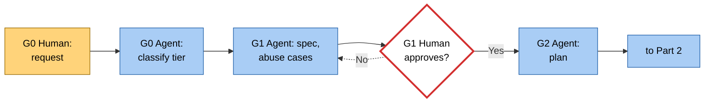

**Part 2: Build, verify, release (G3-G6)**

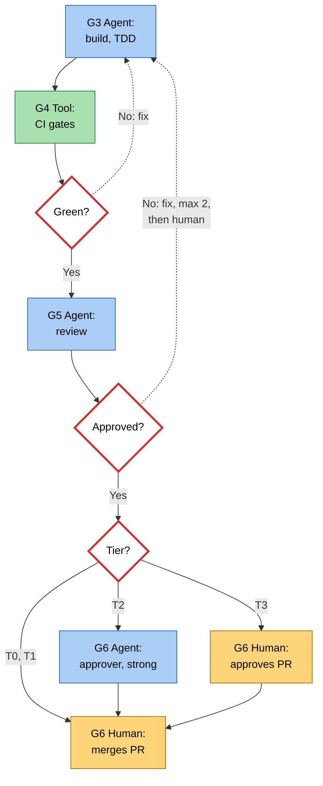

| Gate | Orchestrator does | Human does | Model role | Tool | Evidence required to pass |
|---|---|---|---|---|---|
| G0 Classify | Runs `risk-tier`, writes the tier into the plan; unsure means the higher tier | States the request; confirms every T3 | `mid` | `risk-tier` | Tier line in the plan |
| G1 Spec | T0 none; T1 3-line brief; T2 spec with tests listed; T3 spec with [abuse cases](skills/factory-review/references/abuse-cases-template.md), each row names a test | **Approves the spec at T2/T3** (checklist below) | `small` T1, `mid` T2, `strong` T3 | abuse-case template | Approved spec; T3: every abuse case maps to a test name |
| G2 Plan | Numbered tasks with acceptance criteria, file targets, tests, UI reuse table; saves it in `docs/plans/` | OK for non-trivial work | `mid` | none | Plan file with tier and reuse table (T1-T3) |
| G3 Build | One implementer per task: failing test first, minimal code, fast local checks only (typecheck, changed tests) | none | `small` T0/T1, `mid` T2/T3 | local typecheck and tests | Red-then-green test, diff on a feature branch |
| G4 Tool gates | Reads the CI result, never re-runs it; red CI goes back to G3 (not a fix round) | none | none | lint, types, tests, diff coverage, depcruise, arch suite, build, bundle, SAST, gitleaks, audit; mutation at T3 (opt-in) | Green CI run (link or output) |
| G5 Review | Runs `risk-tier`, dispatches the triggered reviewers with the [brief](skills/factory-review/references/reviewer-brief-template.md), collects verdicts, runs the fix loop | none (only after round 2) | reviewers by role, section 2 | CI output as input | `approve` from every triggered reviewer; T3: one OWASP line per item |
| G6 Release | Pushes the feature branch and runs `pr`; at T2 the approver agent confirms CI green and all verdicts `approve` | Reviews the PR; **T3: records the approval**; merges; deploys rules and indexes; then `finish` | `strong` approver at T2; none at T0/T1 | branch protection | PR link, green checks, T3: human approval in the PR |
| Feedback | Proposes a tool check for each recurring finding | Triages | `mid` | `doctor`, ratchets | Fewer findings of the same kind |

**What the human does at G1** (before any code): the scope matches the request; every abuse case is something an attacker could really do and none is missing for the assets involved (money, roles, public links, uploads); each abuse case names a test; the tier is right; open questions are answered.

**What the human does at G6:** open the PR; check the tier line, green checks and the reviewer verdicts (open `UNCHECKED` items are decided by you); at T3 read the security reviewer's OWASP lines and the abuse-case tests, then leave the approval as a PR review or comment; merge on GitHub; deploy Firestore/Storage rules and indexes yourself (agents never do); run `finish --apply`.

**Pull request flow.** Agents push a feature branch and `npx oneup-standards pr` opens the pull request (body: your template, the computed risk tier, reviewers and commits; without `gh` it prints the compare link and the text to paste). `pr` never merges. The pre-push hook refuses direct pushes to the default branch locally, and `protect-branch` enforces it on GitHub where the plan allows it ([two levels of protection](#two-levels-of-protection)). To stop Claude Code from merging, add `Bash(gh pr merge:*)` to `permissions.deny` in `.claude/settings.json` (`doctor` hints when it is missing). After the merge, `finish` (dry run) and `finish --apply` fetch, fast-forward the default branch and delete the local branch only when it is proven done (merged by ancestry, a merged pull request via `gh`, or every commit already on the default branch by patch-id). `--remote` also deletes `origin/<branch>`; `--worktrees` removes finished worktrees without uncommitted changes. Tip: enable GitHub Settings > General > "Automatically delete head branches". A squash or rebase merge creates new commits, so `git branch -d` refuses; `finish` checks the pull request or patch-ids first and only then uses `-D`.

**Project = full standard, global = bootstrap.** The full standard lives in each project's `AGENTS.md`. `sync-agents --global` writes only a short bootstrap block into `~/.agents/AGENTS.md`; your personal rules go outside the block. This avoids reading the same ~160 lines twice per request.

### Risk tiers

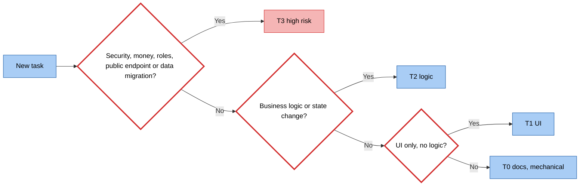

Highest matching tier wins; when unsure take the higher one; a tier may go up during the work, never down. Split mixed changes; the UI part of a T3 change still follows T3 in the shared PR.

| | T0 docs/mechanical | T1 UI | T2 logic | T3 security/money/roles |
|---|---|---|---|---|
| Examples | typo, README, lint autofix, rename | new button variant, spacing fix, screen moved to primitives | new status transition, fee calculation, new staff server action | role change, payment-reported flow, public booking link, Firestore rule, data backfill, upload, email template |
| Spec (G1) | none | 3-line brief | spec with tests listed | spec with abuse cases, each a test |
| Builder (G3) | `small` | `small` | `mid` | `mid` |
| Tool gates (G4) | required | required | required | required, plus mutation and SAST |
| Reviewers (G5) | none | ui, once per batch | logic; architecture and test-quality by path | **security, logic, test-quality always**; ui only for UI paths, architecture only for layer/import/action paths; security is `strong` and answers the OWASP table |
| Fix rounds | n/a | max 2 | max 2 | max 2, then human |
| Approver (G6) | CI green, human merges | CI green, human merges | agent approver (`strong`), human merges | **human approval, always**, then human merges |

**T3 means** a mistake costs money, leaks data, grants access or cannot be undone. Never merged on agent approval alone, whatever the reviewers say.

**G0 by tool: `npx oneup-standards risk-tier [--base <ref>] [--json] [paths...]`** classifies the diff by changed paths (the highest tier of any file wins; exit code 0, 2 on usage errors) and prints the tier, the reviewers to run and whether a human approval is required. Defaults: T3 = `src/app/actions/**`, `src/server/**`, `*.rules`, `**/auth*`, email templates, and paths containing money/payment/fee/role/token-style keywords; T2 = `src/lib/**`, `src/domain/**`, `src/shared/**`, hooks, context and unknown source paths; T1 = `src/components/**`, styles; T0 = docs, tests, config. The tool prints `arch` for the architecture reviewer. Replace the globs of a tier per project in `.standardsrc.json`:

```json
{ "riskTiers": { "T3": ["src/server/**", "billing/**"], "keywords": ["payment", "role"] } }
```

### Fix loop and escalation

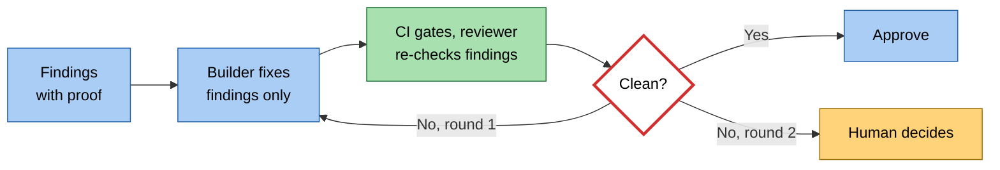

Rules for all agents:
- **No self-approval:** the agent that writes the code never approves it; a reviewer is a fresh session with only spec, diff, abuse cases and CI output plus a specific attack brief.
- **Tools before reviewers:** reviewers read CI output; they never re-run gates or repeat tool findings.
- **Max 2 fix rounds,** then escalation to the human with the open findings. A round is: builder fixes only the findings, CI runs, the reviewer re-checks the findings (not the whole diff).
- A finding a tool could have caught becomes a tool check.
- **Evidence before assertions:** "this should work" is rejected without CI or terminal output.

---

## 2. What each reviewer checks

Every rule is checkable. A tool checks first; the reviewer only judges what the tool cannot. The per-reviewer files in `skills/factory-review/references/` are the source of truth for the principles; this summary cites their ids (`ARCH-3`, `UI-2` ...) and `test/reviewer-ids.test.js` fails when the two drift.

### Common to all reviewers

| Topic | Definition |
|---|---|
| Triggered by | Changed paths (table below). T3: security, logic, test-quality always; ui and architecture by path. T2: logic. T1: ui. T0: none. |
| Reads first | Spec, diff, abuse cases (T3), then the CI/tool output named in the table. Never re-runs gates, never reviews files outside the scope, never restyles. |
| Finding vs pass | **blocker:** a proof (input or test) that a spec rule, abuse case, security, money or state invariant breaks, or a ratchet/baseline grew. **major:** a checklist rule is violated but no breakage is shown yet (e.g. allowed test without denied twin). **minor:** a hint; does not block and gets no fix round. A rule that does not apply is `n/a`, not a finding. |
| Verdict | `approve` (no blocker, no major) \| `changes-requested` \| `escalate` (needs a human decision, or round 2 ends with open blockers). |
| Output (max 40 lines) | `VERDICT`, then `FINDINGS`: id \| severity \| file:line \| proof \| fix hint, then `UNCHECKED`: what could not be verified and why. Security at T3 adds one OWASP line per applicable item: `A01 ok\|finding\|n/a - evidence`. |
| Escalation | Round 2 with open blockers, or any `escalate`, goes to the human with the open findings. T3 additionally always needs the human approval. |

| Reviewer | Trigger paths (default globs, see `risk-tier`) | Model role | Tool output read first | Detailed list |
|---|---|---|---|---|
| security | `src/app/actions/**`, `src/server/**`, `*.rules`, `auth*`, email templates, paths with money/payment/fee/role/token keywords, uploads, public routes; always at T3 | `strong` at T3, `mid` at T2 | SAST, gitleaks, audit, rules tests, mutation report | `security-review.md` |
| ui | `src/components/**`, styles | `mid` (`small` for the checklist of a T1 batch) | lint, style ratchet, visual regression | `ui-review.md`, skill `ui-consistency` |
| logic | `src/lib/**`, `src/domain/**`, `src/shared/**`, services, state machines, unknown source paths; always at T3 | `mid` | unit/service tests, coverage | `logic-review.md` |
| architecture | new folders, changed imports across layers, `src/app/actions/**`, `src/server/**`, `src/domain/**`, depcruise config (never for T0) | `mid` | depcruise, arch suite | `arch-review.md` |
| test-quality | tests of guards, money or state (test paths with guard/money words); always at T3 | `mid` | coverage, mutation report | `test-quality.md` |

### Architecture (finding if a rule below is violated)
- `ARCH-1` Write path is UI -> server action -> service -> adapter. No database write from UI code.
- `ARCH-2` Every file under `src/server/` starts with `import 'server-only'`; the UI never imports from it.
- `ARCH-3`, `ARCH-4` Every exported action guards the caller in its body (or has an explicit public marker with reason and a rate limit), validates input with a schema and returns `{ success, data | error, code? }`; errors do not leak `error.message`; no unguarded helpers exported from actions.
- `ARCH-5` Identity, roles, owners, prices and recipients come from the server, never from the client.
- `ARCH-6`, `ARCH-7` Business rules live in services or the domain. The domain imports only domain and shared; adapters implement its ports.
- `ARCH-8`, `ARCH-9` No cross-layer import (feature to app, service to action, domain to server), no new entry in a ratchet or baseline file.
- `ARCH-10` Docs for roles, collections, upload paths, scripts and CI changed in the same change.

### UI (finding if a rule below is violated; layers: [UI Consistency Guardrails](#ui-consistency-guardrails))
- `UI-1` Tokens: raw values (hex, rgb, palette classes, arbitrary px) exist only in the token layer. Missing step: add a token.
- `UI-2` Primitives: variants via `cva`, classes merged with `cn()`, tokens only, `data-ui` hook, catalog entry, tests, visual-net entry. Decision test: "does it know the domain?" Yes: feature component. No: primitive.
- `UI-3`, `UI-4`, `UI-5` Feature components use primitives; no hand-built buttons or overlays. `className` from the caller is for layout only. Pages only compose.
- `UI-6` The plan's reuse table (reuse vs new, with reason) matches the diff.
- `UI-7`, `UI-8`, `UI-11` New page, modal or sheet has a visual-catalog entry; refactors keep a zero-pixel diff; ratchets and baselines only shrink.
- `UI-9`, `UI-10` Accessibility (label per control, visible focus, keyboard path, token contrast) and empty, loading, error and long-text states exist.

### Logic (finding if a rule below is violated)
- `LOGIC-1` Every spec rule and abuse case has a test that fails when the behaviour is removed.
- `LOGIC-2` State-machine truth table (state x event): no impossible combination, no second write path (edit, import, retry) that skips the transition rule.
- `LOGIC-3` Legacy data matrix (old record shapes x read, display, write, migrate): each cell handled or explicitly out of scope.
- `LOGIC-4`, `LOGIC-5`, `LOGIC-6` Rounding, currency, units, time zones and range edges are covered; double submit, retry and concurrent edits are idempotent or transactional; error paths leave no partial write.
- Output lists only failing cells and missing tests, each with the input that breaks it.

### Security (finding if a rule below is violated; OWASP table below)
- `SEC-1` Enumerate every write path (actions, routes, rules, jobs, imports, edit and bulk twins) and who may call it; the edit twin of a guarded create is the usual bypass.
- `SEC-2` Deny by default: allowed and denied cases for every rule, role and owner check, using the real role lookup (never a mocked `isAdmin`); "signed in" is not authorization; anonymous is not staff.
- `SEC-3`, `SEC-4` Each guard is mutation-checked (remove or invert it once; a test must go red). Stored-markup sanitizers are fuzzed in a real browser.
- `SEC-5`, `SEC-10` Server-side validation (trimmed, capped, closed enums, bounded arrays and files) and ownership re-read; no secrets or confidential data in the client bundle; links only `https:`.
- `SEC-6`, `SEC-7`, `SEC-8` Public endpoints: rate-limited, idempotent, reduced view models (no PII); a short or guessable code is never a credential.
- `SEC-9` Each abuse case maps to a test; no state combination the model forbids (paid but not approved).

| OWASP item (Web 2021 / API 2023) | What the security reviewer checks | Tool-first check |
|---|---|---|
| A01, API1, API5 Access control (object and function level) | Every action guards in its body; ownership/role re-read server-side; edit and bulk twins too; rules deny by default | arch suite action guards, rules tests |
| A02 Cryptographic failures | No secrets in client vars; tokens from a CSPRNG; HSTS/CSP headers | gitleaks, `check-bundle`, header test |
| A03 Injection | Zod at the boundary; no string-built queries or paths; no `dangerouslySetInnerHTML` | ESLint security, Semgrep/CodeQL |
| A04, API6 Insecure design, sensitive business flows | Abuse cases exist and are tests; booking, payment, invites limited per actor and idempotent | abuse-case section present, rate-limit and repeat-call tests |
| A05, API8 Misconfiguration | Security headers, no wildcard CORS or verbose errors, rules and indexes deployed by a human | header and rules tests |
| A06 Vulnerable components | No new unvetted dependency; actions pinned | `npm audit`, Dependabot |
| A07, API2 Authentication | Verified token on the server; anonymous is not staff; capability tokens long, random, expiring | action guard tests with real role lookup, token tests |
| A08, API10 Integrity, unsafe API consumption | CI actions pinned; migrations reversible or dry-run; inbound webhooks validated and signature-checked | pin check, invalid-signature test |
| A09 Logging | Server-side audit entry with verified uid, time, reason; no PII in logs | audit assertion in tests |
| A10, API7 SSRF | Server fetches only allow-listed hosts; user URLs scheme-checked | Semgrep SSRF rule |
| API3 Property-level authorization | Responses are reduced view models; the client cannot write role, price, owner, status | mapper tests with explicit fields |
| API4 Resource consumption | Page, body, upload and array caps; rate limit on public endpoints | Zod bounds, rate-limit test |
| API9 Inventory | No orphan or debug actions/routes; every public action marked with a reason | arch suite public-action list |

### Test quality (finding if a rule below is violated)
- `TQ-2` Every allowed-case test has a denied twin (wrong role, owner, anonymous, expired, out of range).
- `TQ-1` A surviving mutant in a guard, comparison or calculation is a missing test. Without the mutation tool: invert each guard by hand once and confirm a test goes red.
- `TQ-3`, `TQ-4`, `TQ-5` Tests assert explicit values; regenerated snapshots prove nothing. No mocked authorization, no sleeps, real clocks or network.
- `TQ-6` Test names state the rule. Output: surviving mutants (file:line, operator) and the missing test for each.

---

## 3. Adopt it: new and existing projects

**Which command when**

| Situation | Command |
|---|---|
| First time in a project (new or existing) | `npx oneup-standards init` (wizard, 8 steps; `--yes` accepts recommended answers; `--with mutation,dast` adds opt-in checks) |
| Is the project healthy? Drift, hooks, skills, readiness checklist | `doctor` (exit 2 if the project was never connected: run `init`) |
| After bumping the package version | `upgrade --dry-run`, then `upgrade` (`--merge` for customized CI/PR template, `--force` replaces and keeps `.bak`) |
| Refresh only the shared rules in `AGENTS.md`/`CLAUDE.md`/`GEMINI.md` | `sync-agents` (once per machine: `sync-agents --global`) |
| Install AI skills for Antigravity and Claude Code | `sync-skills` (`--project`: workspace only), verify with `check-skills` |
| Freeze legacy violations | `baseline` |
| Opt-in mutation testing, DAST | `add <mutation\|dast\|all>` |
| Require PR and checks on GitHub | `protect-branch` (dry run), then `--apply` |

**New project**

```bash
npx create-next-app@latest my-app && cd my-app && git init
npm install --save-dev github:oneup4real/engineering-standards#semver:^1.0.0
npx oneup-standards init      # then: brew install gitleaks (Windows: winget install gitleaks)
```

1. `init` writes configs, hooks, CI, PR template and the `AGENTS.md` block; it ends with a readiness checklist (what is set up, the command per missing item, what only you can do).
2. Commit, push a feature branch, open the first PR with `pr`, then make the checks mandatory ([section 9](#9-make-the-checks-mandatory-on-github)).
3. No baseline is needed: there are no legacy violations.

**Existing project**: bring legacy code under governance without a red pipeline on day one.

```bash
npm install --save-dev github:oneup4real/engineering-standards#semver:^1.0.0
npx oneup-standards init
brew install gitleaks     # Windows: winget install gitleaks
```

The wizard automates the migration:
- **Smart CI and workflow merging:** keeps your jobs in `.github/workflows/ci.yml` (emulators, Docker services), injects the shared `security` job (`security.yml@v1`: Gitleaks, audit, Semgrep or CodeQL, dependency review); `ci.yml.bak` is always saved.
- **PR template merging:** keeps custom sections, injects missing standard sections and checklists.
- **ESLint and TypeScript:** keeps existing local rules via `eslint.config.local.mjs` while adding the shared security rules.
- **Freezes legacy violations:** creates `.dependency-cruiser-known-violations.json`, so only *new* violations fail.
- **Confidential markers:** configures strings (e.g. `CUST-`) in `.standardsrc.json` that must never appear in client JS bundles.
- **Hooks:** Husky pre-commit (secrets, lint, SAST on staged files) and pre-push (types, tests, audit when the lockfile changed); each check has one local place ([Check matrix](#check-matrix)).

Then: review the changes, commit on a branch, `pr`, merge, `finish --apply`. From then on only new violations fail; pay legacy debt down with the ratchet flow ([Appendix C](#appendix-c-monotonic-ratchets--managing-legacy-debt)). Suggested order for many findings: P0 security issues first (exposed data, missing authorization, secrets); move database writes behind server actions one feature at a time; guard every server action; then clear architecture violations until the baseline file is empty. More in [docs/adoption.md](docs/adoption.md); layer reference in [docs/architecture.md](docs/architecture.md).

---

## 4. Secure SDLC (SSDLC) phase mapping

`@oneup4real/standards` aligns modern AI-assisted engineering with the classical **Secure Software Development Lifecycle (SSDLC)** (NIST SSDF SP 800-218, OWASP SAMM, Microsoft SDL):

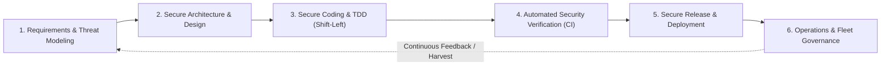

### Detailed Phase Breakdown

G-numbers refer to the gates in [the delivery flow](#1-the-delivery-flow-who-does-what-when).

| SSDLC Phase | Classical Activities (NIST / OWASP) | Threats & AI Failure Modes Mitigated | Enforcement Mechanism & Tools Used | Responsibility / Gate |
|---|---|---|---|---|
| **1. Requirements & Threat Modeling**<br>(G0, G1) | • Abuse case modeling<br>• Trust boundary definition<br>• Security requirements & compliance scope (GDPR/ISO 27001) | AI agents implementing features without considering auth boundaries, data privacy, or business logic abuse. | • `brainstorming` skill<br>• `writing-plans` (formal spec before code)<br>• Definition of Done (`AGENTS.global.md`) | **Human & AI Alignment**:<br>Human approves spec and acceptance criteria before implementation begins. |
| **2. Secure Architecture & Design**<br>(G1, G2) | • Layered defense-in-depth<br>• Principle of Least Privilege<br>• Server-side token verification<br>• Zero-trust database design | Architecture erosion; UI components directly mutating databases; bypass of server-side authorization. | • `depcruise/layered.cjs` (Clean Architecture)<br>• Server action isolation (`src/server/actions`)<br>• Deny-by-default Firestore rules (`allow write: if false`) | **Architectural Rules**:<br>Machine-checked layer boundaries; domain layer remains pure. |
| **3. Secure Coding & Shift-Left Dev**<br>(G3) | • Test-Driven Development (TDD)<br>• Secret scanning on staged changes<br>• Static linting of security rules<br>• Strict typing & type safety | AI hallucinating code without tests; committing credentials, `.env` files, or internal PDFs; using `any` or `dangerouslySetInnerHTML`. | • **Husky hooks** (`pre-commit`, `pre-push`)<br>• **Gitleaks** (`gitleaks protect --staged`)<br>• `oneup-standards check-files`<br>• **ESLint Security Plugin** (`@oneup4real/standards/eslint/nextjs`)<br>• Strict TS (`tsconfig/nextjs.json`) | **Pre-Commit Gate**:<br>Local commit fails immediately if secrets, forbidden files, or lint errors are present. |
| **4. Automated Security Verification (CI)**<br>(G4, G5) | • **SAST** (Static Application Security Testing)<br>• **SCA** (Software Composition Analysis)<br>• **AST Guard Inspection**<br>• **TDD & Diff Coverage**<br>• **Bundle Leak Detection**<br>• **Emulated Rules Testing** | Unguarded server endpoints; vulnerable dependencies; untested edge cases; sensitive markers in browser JavaScript. | • **SAST**: Semgrep / GitHub CodeQL<br>• **SCA**: `npm audit` + Dependabot<br>• **AST Security**: `arch/suite.js` (Action auth guards)<br>• **TDD Gates**: `check-tests-changed` & `check-diff-coverage >= 80%`<br>• **Bundle Audit**: `check-bundle`<br>• **Emulated Testing**: `@oneup4real/standards/firebase-testing` against local emulator | **Pull Request Gate**:<br>Automated reusable CI (`ci-node.yml`, `security.yml`). Unchecked code cannot merge. |
| **5. Secure Release & Deployment**<br>(G6) | • Branch protection<br>• Release gating & Four-Eyes principle<br>• Production security headers<br>• Blast radius containment | Unreviewed AI code pushed directly to production; missing HTTP defense headers; unintended rule deployment. | • GitHub Rulesets (block force push, require PRs & green checks)<br>• Next.js `securityHeaders` (CSP, HSTS, XFO)<br>• Human-only deployment rule for database security rules | **Release Gate**:<br>Human-in-the-loop review; status checks must pass; security rules deployed only by humans. |
| **6. Operations & Fleet Governance**<br>(Feedback) | • Anti-drift management<br>• Vulnerability patching<br>• Technical debt reduction (ratchets) | Repositories drifting from security standards; unpatched dependencies; growing legacy code debt. | • `oneup-standards doctor`<br>• `oneup-standards upgrade`<br>• Monotonic ratchets (`arch-allowlist.json`, `known-violations`)<br>• Weekly Dependabot updates & `standards-automerge` | **Continuous Monitoring**:<br>Ratchets can only shrink; PRs visibly flag configuration drift. |

---

## 5. Tools and risk mitigation matrix

### Check matrix

**Rule: every check has exactly one local place and runs authoritatively in CI; local is a faster subset; reviewers read the output, never re-run.** Which check owns which risk: [docs/architecture.md](docs/architecture.md#which-check-owns-which-risk).

| Check | Local pre-commit | Local pre-push | CI | Nightly / on demand | Reviewer that READS it |
|---|---|---|---|---|---|
| gitleaks (secrets) | staged changes | - | full git history | - | security |
| Forbidden files (`check-files`) | staged | - | all | - | security |
| Lint (ESLint security rules) | staged files | - | all files, `--max-warnings=0` | - | ui, architecture |
| Typecheck (`tsc`) | - | yes | yes | - | logic |
| Unit tests | - | yes (once) | yes, with coverage | - | logic, test-quality |
| Arch rules (depcruise, arch suite, action guards) | - | - | yes | - | architecture, security |
| SAST (Semgrep or CodeQL) | staged files, our rules, report-only | - | `security.yml` | - | security |
| SCA (`npm audit`) | - | only if lockfile changed, online, report-only | `security.yml` | Dependabot weekly | security |
| Dependency review | - | - | PRs (`codeql: true`) | - | security |
| Secrets history scan | - | - | `security.yml` (full history) | - | security |
| Diff coverage (>= 80 %) | - | - | PRs | - | test-quality |
| Tests changed (`check-tests-changed`) | - | - | PRs | - | test-quality |
| Mutation (Stryker) | - | - | opt-in, changed files | on demand | test-quality, security |
| DAST (ZAP) | - | - | - | nightly, opt-in | security |
| Bundle check | - | - | after build | - | security |
| Style ratchet | - | - | arch suite | - | ui |
| `doctor` | - | - | `--warn-only` | on demand | - |

Every tool incorporated into `@oneup4real/standards` is targeted at specific real-world security vulnerabilities and common failure modes of AI coding agents:

| Tool / Technology | SSDLC Phase | Specific Threat / AI Failure Mode Prevented | Secure SDLC Impact |
|---|---|---|---|
| **gitleaks** | Coding (Local) & Testing (CI) | AI accidentally commits API keys, Firebase service account credentials, or `.env` files into git history. | **Secrets & Credential Hygiene**: Halts commits locally; audits full git history in CI. |
| **`check-files`** | Coding (Local) & Testing (CI) | AI commits internal documentation (`.docx`, `.pdf`, `.xlsx`), raw keys (`.pem`, `.key`), or local environments. | **Data Leakage & Asset Sprawl**: Rejects disallowed extensions before staging. |
| **ESLint Security Plugin** | Coding (Local) & Testing (CI) | Direct client writes to DB (`setDoc`, `addDoc`), secret access in `NEXT_PUBLIC_*`, `any` type casts, `dangerouslySetInnerHTML`. | **Injection & Authorization Bypass**: Guarantees writes go through server actions; stops client data poisoning. |
| **dependency-cruiser** | Design & Testing (CI) | UI directly importing server adapters/database modules; circular dependencies; domain layer corruption. | **Architectural Integrity**: Enforces strict boundaries (UI → Boundary → Services → Adapters). |
| **`arch/suite.js` (AST Scanner)** | Testing (CI) | AI creates exposed Server Actions (`'use server'`) without authentication/role guards (`requireAuth`, `requireRole`). | **Broken Object Level Authorization (BOLA/IDOR)**: Guarantees every exported action has a verified session guard. |
| **`check-tests-changed`** | Testing (CI) | AI refactors or adds application logic but skips writing tests, claiming "it works". | **Regression Prevention & TDD**: PR fails if `src/` changes without matching test modifications. |
| **`check-diff-coverage`** | Testing (CI) | AI writes pseudo-tests that run empty assertions or don't execute newly added logic. | **AI Slop Defense**: Requires at least 80% coverage on newly touched lines. |
| **`check-bundle`** | Testing (CI Post-Build) | Internal database IDs (e.g. `CUST-`, `INTERNAL-`) or secret constants leaked into client-side JS bundles. | **Information Disclosure**: Scans client JavaScript in `.next/static` for sensitive markers. |
| **Semgrep / CodeQL** | Testing (CI SAST) | Known insecure coding patterns, prototype pollution, SSRF, path traversal; plus our rules: unsanitized HTML sinks, `Math.random()` for secrets, `error.message` returned from actions. | **SAST**: One pipeline in `security.yml` on every PR (`semgrep: true` or `codeql: true`). |
| **`@oneup4real/standards/firebase-testing`** | Testing (CI Emulated) | Database security rules regressions; unauthorized role privilege escalation in Firestore. | **Authorization Testing**: Automated test runner against local emulator for allowed & denied cases. |
| **`@oneup4real/standards/next/headers`** | Release & Deployment | Clickjacking, MIME sniffing, cross-site scripting (XSS), missing HSTS/CSP. | **Runtime Defense**: Injects hardened production HTTP security headers. |
| **`doctor` & `upgrade`** | Operations & Fleet | Configuration drift: projects initialized months ago missing new security patches and hook updates. | **Fleet Consistency**: Cryptographically tracks template drift and provides safe upgrades. |
| **`ui-consistency` skill + style ratchet** | Design & Coding | AI styles each screen in isolation: one-off font sizes (`text-[10.5px]`), hand-built pills and modals next to existing primitives, drifting spacing and radii. | **UI Integrity**: Primitives are reused, tokens are enforced, and arbitrary style values can only decrease. |
| **Specialist reviewers by tier (`factory-review`)** | Design & Coding | Single agent "cheating" its own evaluation, hallucinating test results, or deviating from plan; blanket reviews that re-run what tools already prove. | **Four-Eyes Governance**: Separates the implementer from path-triggered, fresh-context specialist reviewers; T3 needs a human. |

### Defense-in-depth: SAST vs. linting vs. testing

A common question in engineering teams is: *why do we need three separate verification tools, and where should each one run?*

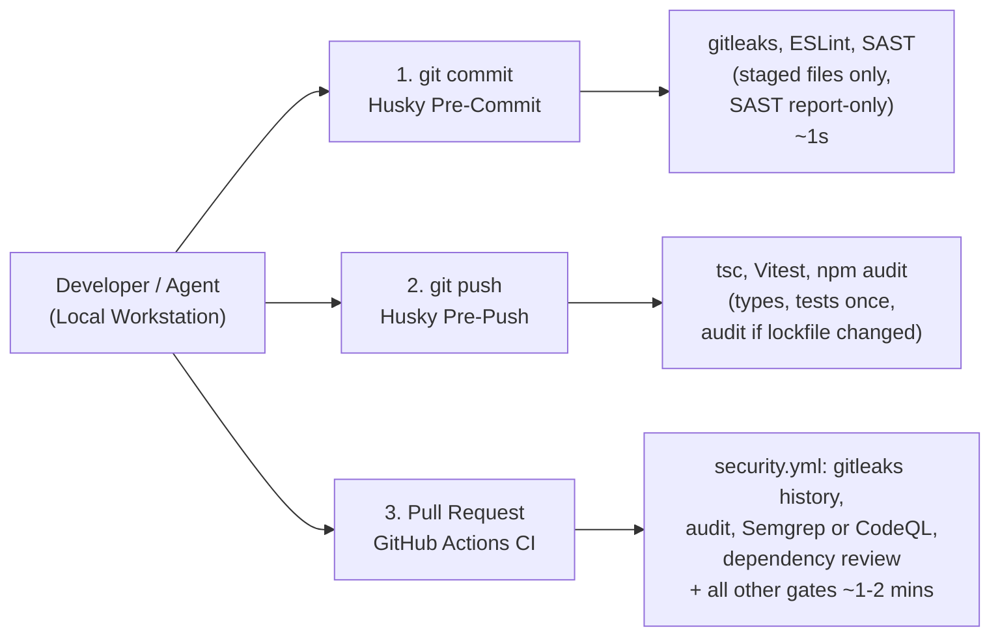

| Defense Layer | Primary Tool | Where It Runs | Primary Objective | Why It Runs There |
|---|---|---|---|---|
| **Behavioral Verification** | **Vitest** | Workstation (pre-push) & CI | Verifies functional behavior, business logic, regressions, and coverage thresholds. | Fast execution (100–500ms) gives instant developer feedback on every push without waiting for cloud CI. |
| **Workstation Linting** | **ESLint** | Workstation (pre-commit) & CI | Catches forbidden AST syntax patterns (direct client DB writes, secrets in `NEXT_PUBLIC_*`, `any` type casts). | Sub-second AST parsing blocks dangerous patterns before code is ever committed to local history. |
| **Deep Code Analysis (SAST)** | **Semgrep** (registry packs + our rules) / **CodeQL** | CI (`security.yml`); our rules also on staged files locally | Semantic taint-tracking, SSRF, injection vulnerabilities, prototype pollution across file boundaries. | Comprehensive vulnerability rule suites require containerized runtimes and multi-file AST indexing, which would unacceptably slow down local git commit workflows. Locally only our small rule file runs, on staged files. |

> **Direct push to `main`?** The pre-push hook refuses it locally (works on private repos on the free plan). Local hooks can be bypassed with `--no-verify`, so the binding guard is on GitHub, where the plan allows it: a branch ruleset or `protect-branch` blocks direct pushes and requires a pull request with green checks ([section 9](#9-make-the-checks-mandatory-on-github)). As a second net, a project's `ci.yml` normally also triggers on `push` to `main`, so SAST and secret scans still run and alert.

---

## 6. Architectural guardrails and threat boundaries

Applications using these standards follow a strict layered Clean Architecture:

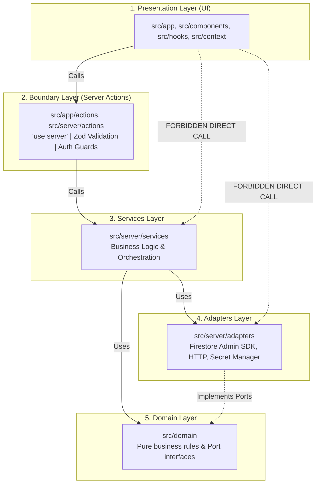

### Invariant Rules
1. **Server-Only Isolation:** Every file in `src/server/` must begin with `import 'server-only';`.
2. **Deny Client Writes:** In Firebase/Firestore apps, client security rules enforce `allow write: if false;`. All mutations go through Server Actions using the Admin SDK.
3. **Domain Purity:** `src/domain` contains only pure logic and interfaces. It may only import `src/domain`, `src/shared`, or `zod`. No framework, UI, or database imports.
4. **Action Contract:** All server actions return a unified response shape:
   ```ts
   type ActionResult<T> =
     | { success: true; data: T }
     | { success: false; error: string; code?: string };
   ```

### UI Consistency Guardrails

AI agents build UI one screen at a time. Without guardrails, each screen picks its own font sizes, spacing and
"almost the same" pill or card, and the app slowly stops looking like one product. The standard treats the
presentation layer like the server layers: a fixed structure, written rules, and an automated check.

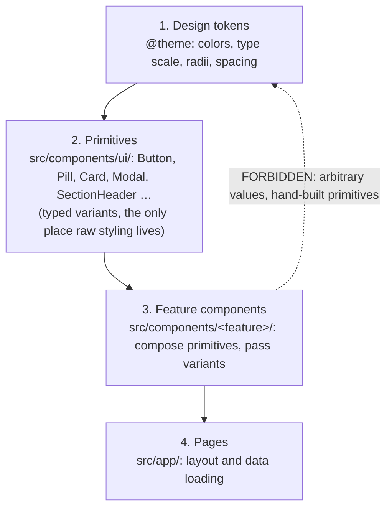

| Layer | Owns | Rule |
|---|---|---|
| **Tokens** (`@theme` in `globals.css`) | Color roles, type scale (`text-label`, `text-body`, `text-title` …), radii, spacing | Missing a step? Add a token. Never an arbitrary value. |
| **Primitives** (`src/components/ui/`) | Look and behaviour of reusable building blocks, with typed variants (`variant`, `size`, `tone`) | The only folder allowed to use raw styling. Exported from `ui/index.ts`. Listed in the catalog. |
| **Feature components** | Domain UI (ticket card, booking sheet) | Compose primitives. Extend a primitive with a variant instead of copying it. |
| **Pages** | Routing, data loading, layout | No styling decisions beyond layout. |

**Reference stack for primitives** (full examples in `skills/ui-consistency/references/react-primitives.md`):

| Concern | Standard |
|---|---|
| Variants | `cva` (class-variance-authority) with typed `variant` / `size` props |
| Class merging | One `cn()` helper (`clsx` + `tailwind-merge`, extended with the project's custom tokens) |
| Interactive parts | Recommended: Radix UI (or React Aria) for dialog, popover, dropdown, tabs, select (focus trap, ESC, ARIA included). Allowed: the project's own implementation, as exactly one primitive per kind, documented in the UI catalog |
| Composition | `children`, compound components (`Card.Header`), `asChild` for polymorphic rendering |
| Tokens | Named by role (`text-label`, `bg-status-success`), raw values only in `@theme` |
| Outside `className` | Layout only; look comes from variants |

This is the shadcn/ui approach: the primitives live in the project's own repository and are owned and
changed there. They are not an external component library.

**Refactoring existing UI without visual change.** Moving an existing app onto this structure must not change
how it looks:

1. Freeze every screen with visual regression screenshots (Playwright `toHaveScreenshot`, seeded data,
   fixed viewport, animations off) **before** the first refactor.
2. Introduce tokens with exactly today's values (1:1). Merging similar values is a separate design decision.
3. Migrate one primitive at a time across all usages. Zero pixel diff, then commit.
4. A diff means the refactor is wrong. Snapshots are only updated with the human's explicit approval.

**Three enforcement layers**, the same pattern as the security rules:

1. **Prompt level:** `AGENTS.global.md` requires the `ui-consistency` skill. Before writing UI, the agent reads the
   project's UI catalog and primitives and puts a *reuse table* (element → primitive) in its plan. The reviewer
   subagent checks UI changes against the catalog. `frontend-design` is reserved for new products and redesigns
   the human asked for.
2. **Project level:** each project documents its primitives folder, catalog (`docs/UI_GUIDELINES.md`) and token
   scale in the "UI catalog" section of its `AGENTS.md`.
3. **CI level:** the style ratchet (`checkStyleRatchet`) counts arbitrary Tailwind values outside the primitives
   folder: `text-[11px]`, `rounded-[18px]`, `p-[13px]`, `bg-[#0062e0]`. `var(--token)` values and widths/heights are
   not counted. Counts are frozen once by the human and may only go down (see [Appendix C](#appendix-c-monotonic-ratchets--managing-legacy-debt)).

**Enable the style ratchet in a project:**

```json
// .standardsrc.json
{
  "uiStyleRatchet": {
    "dirs": ["src/app", "src/components"],
    "exclude": ["src/components/ui/"],
    "allowlistFile": "ui-style-baseline.json"
  }
}
```

```ts
// tests/arch/standards.test.ts
defineArchSuite({
  root: path.resolve(import.meta.dirname, '../..'),
  // …existing options
  styleRatchet: true,
});
```

Then the human runs `npx oneup-standards baseline` once and commits `ui-style-baseline.json`.

---

## 7. Cross-harness AI skill governance

Modern engineering teams often switch between **Claude Code CLI** and **Google Antigravity IDE** (often running Claude models directly inside Antigravity) — or work exclusively in Antigravity.

### The Cross-Harness Problem
1. **Harness Sandbox Boundary:** Claude Code stores plugins in `~/.claude/plugins/cache/`. When you run Claude *inside Antigravity*, Antigravity acts as the host harness. Its security policy explicitly blocks tools from reading foreign tool directories (`Permission denied: Matches default system policy`).
2. **Standalone Antigravity Environments:** Developers using Antigravity without Claude Code installed previously could not obtain the required skills because the toolchain assumed the Claude plugin CLI was available.
3. **Snapshot Drift:** Manually copying skill folders (like Superpowers, Frontend Design, or Superdesign) into projects creates frozen snapshots that never receive upstream bugfixes or feature updates.
4. **The Risk of Forgotten Skills:** If skills are not loaded, the AI agent falls back to generic, non-TDD behavior without threat modeling or systematic debugging.

### Machine-Enforced Skill Protection

`@oneup4real/standards` provides five layers of machine enforcement to guarantee required skills are active across both Claude Code and Antigravity:

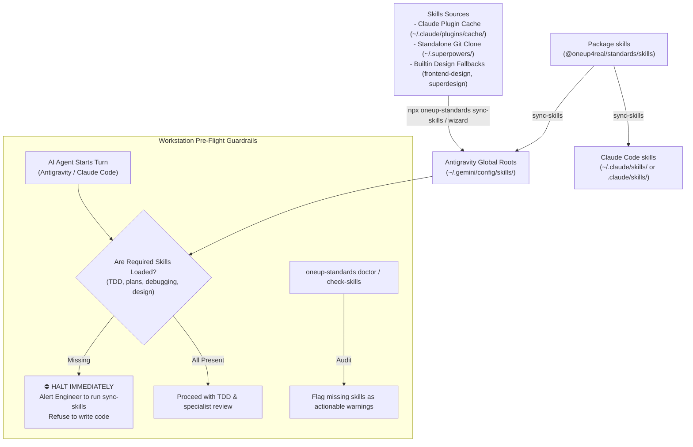

#### 1. Zero-Forget AI Pre-Flight Gate (`AGENTS.global.md`)
Section 0 of `AGENTS.global.md` (rules for tiers and roles: section 1b) instructs every AI model at the prompt level:
- Before writing code, the agent MUST verify that essential skills (`brainstorming`, `writing-plans`, `executing-plans`, `test-driven-development`, `systematic-debugging`, `verification-before-completion`, `requesting-code-review`, `frontend-design`, `superdesign`, `ui-consistency`, `factory-review`) are loaded in its context.
- **Halt Condition:** If any core skills are missing, the agent **stops immediately** and alerts the developer:
  > ⚠️ **Required AI Skills Missing!** Run `npx oneup-standards sync-skills` in your terminal to synchronize your skills into Antigravity, then restart this conversation.

#### 2. Intelligent Harness Detection in Setup Wizard (`init`)
When running `npx oneup-standards init`, the setup wizard automatically senses your environment:
- **Claude Code detected:** Offers to install Superpowers via the Claude marketplace:
  `claude plugin install superpowers@superpowers-marketplace`
- **Antigravity detected (Claude Code absent):** Automatically detects Antigravity (`~/.gemini` or `.agents`), clones Superpowers directly via Git into `~/.superpowers`, and synchronizes all skills into `~/.gemini/config/skills/` — **zero dependency on Claude Code CLI**.
- **Design Fallbacks:** Automatically provisions built-in fallbacks for `frontend-design` and `superdesign` if they are not yet present in upstream caches.

#### 3. Flexible Multi-Path Synchronization (`sync-skills`)
Synchronize skills into Antigravity with zero manual copying. `sync-skills` dynamically searches across multiple cache layouts:
- Claude marketplace caches (`~/.claude/plugins/cache/superpowers-marketplace/**/skills`)
- Standard plugin caches (`~/.claude/plugins/cache/**/skills`)
- Standalone Git clone repositories (`~/.superpowers/skills`)
- Antigravity custom roots (`~/.gemini/config/skills`)

`sync-skills` also installs the package's own skills (see "Standard-Owned Skills" below) for Claude Code (`~/.claude/skills`, or `.claude/skills` with `--project`).

```bash
# Sync all skills globally for all projects opened in Antigravity:
npx oneup-standards sync-skills

# Or sync locally into the current project workspace (.agents/skills):
npx oneup-standards sync-skills --project
```

#### 4. Verification & Doctor Integration
```bash
# Explicitly verify installed skills before starting work:
npx oneup-standards check-skills

# Doctor checks your Antigravity skills directory during routine audits:
npx oneup-standards doctor
```

#### 5. Standard-Owned Skills
Some skills belong to the standard itself and ship inside `@oneup4real/standards` (`skills/`), currently
`ui-consistency` and `factory-review` (risk tiers, model roles, specialist reviewer checklists, OWASP Web and API Top 10 review). They are versioned with the package, override any plugin skill with the same name, and are
installed for both Antigravity and Claude Code by `sync-skills`. `doctor` reports them as missing or outdated
after a package upgrade; `upgrade` or `sync-skills` refreshes them.

---

## 8. Fleet anti-drift: doctor and upgrade

As `@oneup4real/standards` evolves, how do you prevent older projects from becoming out-of-date?

### Diagnose with `doctor`

Run `doctor` to inspect your repository's files, git hooks, AI agent blocks, and environment readiness:

```bash
npx oneup-standards doctor
```

Output:
```
Standards drift / issues detected:
  outdated     .github/pull_request_template.md    older version that was never edited; `upgrade` replaces it
  missing      .lintstagedrc.json                  missing; `upgrade` adds it
  missing      package.json                        missing scripts: check:arch; `upgrade` adds them

Run `npx oneup-standards upgrade` to synchronize configuration files.
```

In CI, `oneup-standards doctor --warn-only` runs automatically on pull requests to highlight drift without failing the build.

`doctor` also prints **hints** (never failures, exit code unchanged; GitHub notices with `--warn-only`): no SAST/SCA in the workflows (the shared `security.yml` counts), mutation testing not set up, a project `.husky/pre-commit` that repeats `tsc` or tests (`hook-duplicate-checks`, with the exact lines to remove), specs without a risk tier or an "Abuse cases" section, `npm run test:unit` and the CI vitest step pointing at different test projects (heuristic), the full standards block present in both the project `AGENTS.md` and `~/.agents/AGENTS.md` (read twice, costs tokens; the short global bootstrap does not count), the default branch without branch protection (`branch-protection`; needs `gh`, skipped in CI), and the `factory-review` skill not installed.

### Safe Synchronization with `upgrade`

The `upgrade` command automatically updates outdated templates, creates missing files, appends missing hook lines, and refreshes the managed AI rules block in `AGENTS.md`:

```bash
# Preview changes without modifying disk:
npx oneup-standards upgrade --dry-run

# Apply safe upgrades:
npx oneup-standards upgrade

# Smart non-destructive merge (recommended for customized projects):
# Keeps your custom CI jobs (e.g. Firebase emulators) and PR template sections,
# while injecting missing shared security scans (Semgrep, Gitleaks) and TDD checks:
npx oneup-standards upgrade --merge

# Force replacement of customized files (creates .bak backups):
npx oneup-standards upgrade --force
```

> **Safety Guarantee:** `upgrade` uses cryptographic SHA-256 fingerprints stored in `.standardsrc.json`. It will **never** overwrite a template file that you customized locally, unless you explicitly pass `--force`. When `--merge` is used, customized files are intelligently merged without losing project-specific features, and their merged fingerprints are recorded so `doctor` recognizes them as up to date.

### Smart Non-Destructive Merging (`--merge`)

When a project edits a managed file (for instance, adding a Firebase emulator runner to `.github/workflows/ci.yml`), `doctor` reports it as `customized`. Instead of choosing between skipping upgrades and overwriting with `--force`, `upgrade --merge` combines both using AST-aware mergers:

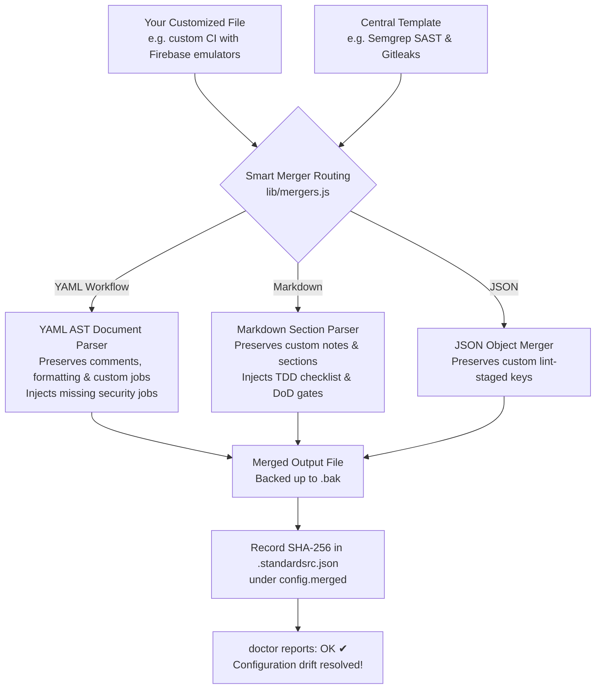

1. **YAML Workflows (`ci.yml`):** Uses native YAML AST parsing to preserve comments, indentation, and custom jobs (like Firebase emulator setups). If your project already has a test runner, it retains it and injects the central `security` job (`security.yml@v1` with Semgrep, Gitleaks, and audit).
2. **Markdown Files (`pull_request_template.md`):** Parses Markdown `## ` sections. Keeps your custom PR description templates intact while injecting missing standards sections (such as *Tests (test-driven development)*) and checklist items (`- [ ]`).
3. **JSON Configs (`.lintstagedrc.json`):** Preserves custom file-match patterns while adding missing standards linters.
4. **Safety:** a timestamped `.bak` copy is written before any customized file changes; the merged hash is recorded under `config.merged[relFile]`, so `doctor` reports the file as `ok` (see [Appendix B](#appendix-b-cryptographic-anti-drift-fingerprinting)).

## 9. Make the checks mandatory on GitHub

Local hooks catch mistakes on your machine, but GitHub branch protection prevents anyone (human or agent) from bypassing them with `--no-verify`. It is also what enforces the [pull request flow](#1-the-delivery-flow-who-does-what-when): nobody pushes to `main`, only a human merges.

### Two levels of protection

| | Local guard (default) | GitHub branch protection |
|---|---|---|
| How | `hook pre-push` refuses a push to the default branch (`hooks.protectDefaultBranch`, default `true`; `hooks.defaultBranch` overrides `origin/HEAD`) | `npx oneup-standards protect-branch` |
| Works on | everywhere, including private repositories on the free plan | public repositories, or a GitHub Pro / Team plan (the API answers 403 "Upgrade to GitHub Pro or make this repository public" otherwise) |
| Stops | accidental direct pushes by agents and people; feature branches, tags and branch deletes still work | everyone, technically binding on the server |
| Does not stop | someone who edits the hooks or uses `--no-verify` | nothing it covers |
| Override | a human, once: `ONEUP_ALLOW_DEFAULT_PUSH=1 git push ...` (agents never set it) | admins only, if you did not use `--include-admins` |
| Use | always | **recommended** as soon as more than one person works in the repo, or when the default branch deploys to production |

With several people, a Pro account (or an organisation plan) plus `protect-branch` is the better choice. `doctor` shows both lines (`Local default-branch guard`, `Branch protection`); on the free plan the second reads `n/a`. Claude Code tip: add `Bash(gh pr merge:*)` and `Bash(git push origin main:*)` to `permissions.deny` in `.claude/settings.json`.

### 1. Branch Ruleset (Repository Settings → Rules → Rulesets)
Create a ruleset targeting the default branch:
- ✅ **Restrict deletions**
- ✅ **Block force pushes**
- ✅ **Require a pull request before merging**
- ✅ **Require status checks to pass:**
  - `ci / ci` *(or your custom job name if merged, e.g. `validate`)*
  - `security / gitleaks`
  - `security / audit`
  - `security / semgrep` *(or `security / codeql`)*

### 2. Code Security (Repository Settings → Code security)
- Enable **Secret scanning** and **Push protection**.

> **Why this is non-negotiable:** local hooks can be bypassed with `--no-verify` and SAST runs only in CI. A ruleset guarantees that **all** code passes SAST, secret audits and architecture checks before it can be merged.

With `gh` installed, `init` (step 8/8) can create this ruleset for you. Quicker alternative, classic branch protection: `npx oneup-standards protect-branch` prints the exact API payload and the click path (dry run). Add `--apply` to send it through `gh`. Flags: `--branch main`, `--checks "ci / ci,security / audit"` (default: the check runs of the latest commit, if `gh` is available), `--approvals 0` (a human merges; raise it for a second reviewer), `--include-admins` (admins cannot bypass either). It needs admin rights, and private repositories need a paid GitHub plan. `doctor` hints when the default branch is unprotected (never in CI). On a private repository on the free plan GitHub answers 403; `protect-branch --apply` then exits 2 with a clear message and the local guard stays your protection.

---

## 10. What happens when

| Event | Execution Target | Checks Executed | Fail Conditions |
|---|---|---|---|
| `git commit` | Local Machine (`.husky/pre-commit`) | `check-files`, `gitleaks protect`, `lint-staged`, SAST on staged files (`semgrep` installed; report-only unless `hooks.sastBlocking`) | Staged keys/env files, exposed credentials, lint errors. |
| `git push` | Local Machine (`.husky/pre-push`) | `tsc --noEmit`, `npm test` once, `npm audit` only when `package-lock.json` changed and the network is up (report-only unless `hooks.auditBlocking`; level `hooks.auditLevel`, default `high`); first refuses a push to the default branch (`hooks.protectDefaultBranch`; human override `ONEUP_ALLOW_DEFAULT_PUSH=1`) | TypeScript type errors, failing unit tests. |
| **Pull Request (CI Pipeline)** | GitHub Actions (`ci-node.yml`) | • Standards doctor drift scan<br>• Forbidden file audit<br>• ESLint (`--max-warnings=0`)<br>• TypeScript compile<br>• Vitest with coverage<br>• `check-tests-changed` (TDD)<br>• `check-diff-coverage` (≥80%)<br>• dependency-cruiser layers<br>• `arch/suite.js` (action guards & write ratchets)<br>• Production build<br>• `check-bundle` confidential scanner | Any warning or error, missing tests on source edits, diff coverage < 80%, layer violations, unguarded server actions, confidential bundle leaks. |
| **Pull Request (Security)** | GitHub Actions (`security.yml`) | • Pinned Gitleaks full history audit<br>• `npm audit`<br>• Semgrep SAST / CodeQL<br>• Dependency review | Leaked secrets anywhere in git history, high/critical CVEs, insecure AST patterns. |
| **Weekly** | Dependabot | Weekly check for new `@oneup4real/standards` releases | Outdated central standards package. |

---

## 11. A check failed. What now?

| Failure Message / Symptom | Root Cause | Proper Remediation |
|---|---|---|
| `These files must not be committed` | A `.docx`, `.xlsx`, `.pdf`, `.env`, or credential file was staged. | Run `git restore --staged <file>`. Store documents in secure document management (SharePoint/Drive) and secrets in Secret Manager. |
| `gitleaks found a possible secret` | Secret or API key detected in staged diff or commit history. | Remove from file. If it was ever committed to history, **revoke and rotate the credential immediately**. |
| `UI code must not write to the database` | Direct Firestore/DB mutation (`setDoc`, `addDoc`) inside UI component. | Move the database mutation behind a Server Action (`src/app/actions`) and Service (`src/server/services`). |
| `exported action "x" has no guard call` | Exported `'use server'` function lacks an authentication guard. | Invoke `await requireAuth()` or `await requireRole('admin')` at the beginning of the function, or mark explicitly with `// @public-action: <reason>`. |
| `missing import 'server-only'` | Server file can be leaked into browser bundle. | Add `import 'server-only';` as the first line of the file. |
| `Source code changed, but no test file changed` | Modified application logic without adding or updating tests. | Write the failing test first. If truly non-functional (e.g. pure docs/copy change), add the PR label `no-tests-needed`. |
| `Changed-line coverage ... is below 80%` | Newly added lines of code are not exercised by tests. | Add test cases specifically covering the uncovered lines shown in the CI terminal output. |
| `Confidential data found in the client bundle` | Sensitive marker (e.g. `CUST-`) compiled into `.next/static`. | Remove client import of server-side data models; pass only sanitized view models across the wire. |
| `shrink the entry in arch-allowlist.json` | You eliminated legacy direct DB writes! | Decrease the count in `arch-allowlist.json`. The ratchet only allows downward movement. |

> **Critical Rule:** Never bypass checks using `git commit --no-verify`, disable rules in ESLint, or inflate ratchet numbers. Fix the underlying code.

---

## 12. CLI commands reference

All commands run as `npx oneup-standards <command>` (`--help` lists them). Daily: `doctor`, `risk-tier`, `pr`, `finish`, `add`. Which command when: [section 3](#3-adopt-it-new-and-existing-projects).

| Command | Arguments / Flags | Description |
|---|---|---|
| `init` | `[--yes] [--with <features>]` | Interactive 8-step setup wizard for new or existing projects (`--yes` accepts recommended answers; `--with mutation,dast` adds opt-in checks). |
| `doctor` | `[--warn-only]` | Diagnoses drift, hooks, outdated templates, AI skills; shows ratchet debt and a readiness checklist (OK / missing / n/a, exact command per item, what you still do yourself). `--warn-only` emits GitHub annotations and exits 0. Exit 2 if the project is not connected. |
| `upgrade` | `[--merge] [--force] [--dry-run]` | Synchronizes managed templates, hooks and the AI rules block. Never overwrites customized files unless `--merge` (combine) or `--force` (replace, keeps `.bak`). |
| `sync-skills` | `[--project] [--dry-run]` | Synchronizes plugin skills (`superpowers`, `frontend-design`, `superdesign`, …) into Antigravity (`~/.gemini/config/skills`) and installs the package's own skills (`ui-consistency`, `factory-review`) for Antigravity and Claude Code (`~/.claude/skills`). |
| `check-skills` | none | Verifies required AI skills (`test-driven-development`, `brainstorming`, `superdesign`, etc.) are installed in Antigravity. |
| `baseline` | none | Generates `.dependency-cruiser-known-violations.json`, `.eslint-suppressions.json` and, when `uiStyleRatchet` is configured, the UI style baseline, freezing existing violations into monotonic ratchets. |
| `sync-agents` | `[--global]` | Refreshes managed shared rules in `AGENTS.md`, `CLAUDE.md`, and `GEMINI.md`. `--global` writes only a short bootstrap block into `~/.agents/AGENTS.md` (and `~/.codex/AGENTS.md`), replacing an old full block and keeping your text. |
| `pr` | `[--title t] [--draft] [--base b] [--push]` | Opens a pull request from the current feature branch (refuses on the default branch). Body: PR template + computed risk tier + commits. Uses `gh pr create` when signed in, otherwise prints the compare URL and the text. Pushes only with `--push`. Never merges. |
| `finish` | `[--apply] [--branch n] [--remote] [--worktrees]` | After a merge: fetch, fast-forward the default branch, delete the local branch if proven done (dry run by default; refuses with uncommitted changes; never deletes unproven branches). |
| `protect-branch` | `[--branch main] [--checks a,b] [--approvals 0] [--include-admins] [--apply]` | Dry run by default: prints the GitHub branch-protection payload and the click path. `--apply` sends it with `gh` (admin rights; private repos need a paid plan). |
| `check-files` | `[paths...]` | Fails if specified paths (default: staged files) contain office docs, keys, or `.env` files. |
| `check-bundle` | `[--dir <path>]` | Scans production JavaScript bundles for confidential markers configured in `.standardsrc.json`. |
| `check-tests-changed` | `--base <git-ref>` or explicit paths | Enforces TDD by failing if source code changed without corresponding test modifications. |
| `check-diff-coverage` | `--base <ref> \| --diff-file <f>` `[--min 80] [--lcov coverage/lcov.info] [--if-present]` | Fails if newly added or modified lines have less than the required test coverage percentage. |
| `hook` | `pre-commit \| pre-push` | Runs the git hook sequences installed by Husky. Options in `.standardsrc.json`: `hooks.sastBlocking`, `hooks.auditBlocking`, `hooks.auditLevel`, `hooks.protectDefaultBranch` (default `true`), `hooks.defaultBranch`. `pre-push` reads the pushed refs from stdin first and refuses the default branch. |
| `risk-tier` | `[--base <ref>] [--json] [paths...]` | Classifies the diff into T0-T3 by changed paths (default base `origin/main`; globs configurable under `riskTiers` in `.standardsrc.json`), prints tier, reviewers and whether a human approval is required. Exit 0 (2 on usage errors). |
| `add` | `<mutation\|dast\|all> [--force] [--dry-run]` | Opt-in templates, never installed by default: Stryker config + changed-files CI job, nightly OWASP ZAP baseline. Same via `init --with mutation,dast`. Report only until a repository variable switches blocking on (see [docs/adoption.md](docs/adoption.md)). SAST and SCA are not templates: they are part of the shared `security.yml`. |

---

## 13. Importable building blocks

Projects consuming `@oneup4real/standards` can import standard presets directly:

| Import Path | Type | Description |
|---|---|---|
| `@oneup4real/standards/eslint/nextjs` | ESLint Config | Next.js flat ESLint preset with security rules, strictness, and React hooks validation. |
| `@oneup4real/standards/eslint/base` | ESLint Config | Framework-agnostic base ESLint flat configuration (supports ESM, CJS, `.cjs` files, and Node env). |
| `@oneup4real/standards/tsconfig/nextjs.json` | TSConfig | Strict TypeScript compiler settings for Next.js applications. |
| `@oneup4real/standards/tsconfig/base.json` | TSConfig | Strict base TypeScript settings (`noImplicitAny`, `strictNullChecks`). |
| `@oneup4real/standards/depcruise/layered` | Dependency Cruiser | Clean Architecture layer dependency validation rules. |
| `@oneup4real/standards/vitest` | Vitest Config | Preset configuring coverage thresholds (≥90% domain coverage) and reporting. |
| `@oneup4real/standards/arch/suite` | Arch Test Kit | `defineArchSuite()`: Automates checks for `server-only`, Action guards, write ratchets and the UI style ratchet (`styleRatchet: true`). |
| `@oneup4real/standards/arch` | Arch Checkers | Pure checkers (`checkServerOnly`, `checkActionGuards`, `checkCallRatchet`, `checkStyleRatchet`, `countArbitraryStyles`) for custom test setups. |
| `@oneup4real/standards/firebase-testing` | Test Helpers | Firebase emulator testing utilities (`assertEmulator`, `createRulesEnv`, `withRoles`). |
| `@oneup4real/standards/next/headers` | Next Config | Production security headers (`securityHeaders({ firebase: true })`) including CSP, HSTS, and XFO. |

---

## 14. Appendices

### Appendix A: The Three Delivery Channels

`@oneup4real/standards` does not require publishing to the public npm registry or managing private registry tokens:

```
  engineering-standards (GitHub)                        your project
  ─────────────────────────────                        ────────────────────────────────────────────
  ① npm package  @oneup4real/standards   ── npm install ──▶  node_modules/@oneup4real/standards/
     (CLI, configs, checks, AST scanners)                    + one line in package.json
                                                              + exact commit pinned in package-lock.json

  ② reusable CI workflows                ◀── fetched by GitHub ── .github/workflows/ci.yml
     .github/workflows/ci-node.yml             on every run        ("uses: …/ci-node.yml@v1")
     .github/workflows/security.yml

  ③ small files written ONCE by wizard  ─────────────▶  eslint.config.mjs, .husky/pre-commit,
     (managed via doctor & upgrade)                          AGENTS.md block, .standardsrc.json …
```

1. **Git Dependency:** Installed via `"@oneup4real/standards": "github:oneup4real/engineering-standards#semver:^1.0.0"`. npm downloads the tarball directly from GitHub matching the semver range. `package-lock.json` pins the immutable git commit SHA.
2. **Reusable Workflows:** Reference `uses: oneup4real/engineering-standards/.github/workflows/ci-node.yml@v1`. The `@v1` tag points to the latest stable 1.x release, allowing immediate distribution of CI security patches without requiring PRs in individual repos.
3. **Managed Consumer Pointers:** Tiny files pointing back to ① and ②.

---

### Appendix B: Cryptographic Anti-Drift Fingerprinting

To solve configuration drift without destroying developer customizations, `lib/doctor.js` and `lib/templates.js` implement SHA-256 fingerprint tracking:

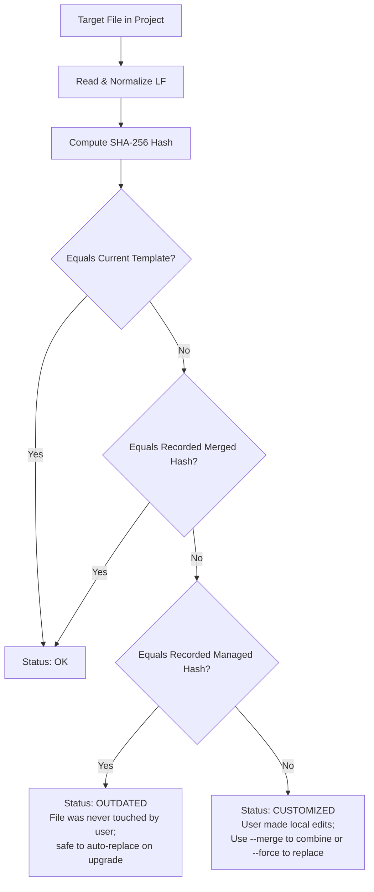

- When the wizard writes a template, it records `managed[relFile] = "sha256:..."` in `.standardsrc.json`.
- `upgrade` replaces `outdated` files automatically.
- `customized` files can be non-destructively merged with `upgrade --merge` (which injects missing standard jobs/sections and records the merged fingerprint in `merged[relFile]`), or replaced with `upgrade --force` (which preserves an exact backup copy as `<file>.bak`).

---

### Appendix C: Monotonic Ratchets & Managing Legacy Debt

Adopting uncompromising engineering and security standards in pre-existing, production codebases often presents a major dilemma:
* **The "Big Bang" Trap:** Halting all feature work for months to fix thousands of legacy issues is commercially unfeasible.
* **The "Lax Rules" Trap:** Weakening or disabling rules to "make CI green" accumulates permanent technical debt and introduces critical vulnerabilities.

The **Monotonic Ratchet Pattern** solves this dilemma. Like a mechanical ratchet that only turns in one direction, the standards framework allows you to **freeze legacy debt on day one** while mathematically guaranteeing that debt only ever decreases:

$\text{Debt}_{t+1} \le \text{Debt}_t \quad \text{and} \quad \text{New Violations} = 0$

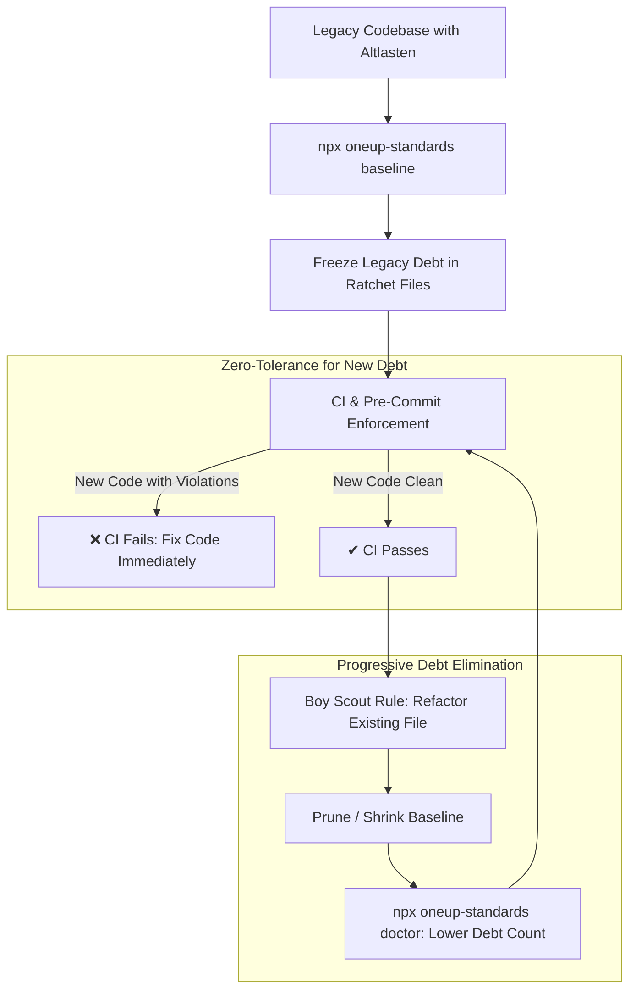

---

#### 1. The Framework Ratchets

| Ratchet Type | Baseline File | Scope & Risk Mitigated | Creation Command | Paydown / Pruning Command |
|---|---|---|---|---|
| **ESLint Suppressions** | `.eslint-suppressions.json` | Untyped `any`, unused vars, unsafe React/Next.js patterns, deprecated syntax. | `npx oneup-standards baseline` | `npx eslint . --suppressions-location .eslint-suppressions.json --prune-suppressions` |
| **Architecture Layers** | `.dependency-cruiser-known-violations.json` | Cross-layer import leaks (e.g. UI importing DB adapters directly instead of Server Actions). | `npx oneup-standards baseline` | Refactor imports, then run `npx oneup-standards baseline` |
| **Direct DB Writes** | `arch-allowlist.json` | Direct client-side Firestore/database mutations (`addDoc`, `setDoc`) bypassing backend validation. | `arch/suite.js` template | Move write to Server Action/Service, then decrement count in `arch-allowlist.json` |
| **Server Action Guards** | `arch-action-gaps.json` | Exported server actions lacking authentication checks or explicit `@public-action` audit comments. | `arch/suite.js` template | Add `requireAuth()` or `@public-action` comment, then remove entry from file |
| **UI Style Values** | `ui-style-baseline.json` (name configurable via `uiStyleRatchet.allowlistFile`) | Arbitrary UI style values per file outside the primitives folder. | `npx oneup-standards baseline` | Replace the value with a token or primitive variant, then run `npx oneup-standards baseline` |

---

#### 2. The Step-by-Step Flow: From Altlasten to Clean Code

##### Phase 1: Freeze Existing Debt (Initial Baseline)
When onboarding an existing repository to `@oneup4real/standards`:
1. Run the initial baseline command to snapshot all pre-existing violations:
   ```bash
   npx oneup-standards baseline
   ```
   *Output:*
   ```text
   ✔ Wrote .dependency-cruiser-known-violations.json (architecture violations baselined).
   ✔ Wrote .eslint-suppressions.json (legacy lint violations baselined).
   Commit these files; they act as monotonic ratchets and may only shrink from now on.
   ```
2. Check the initial debt metrics with `doctor`:
   ```bash
   npx oneup-standards doctor
   ```
   *Output:*
   ```text
   Technical debt & ratchets (monotonic baselines):
     ESLint suppressions              787 violations across 85 files      (.eslint-suppressions.json)
     Architecture layer violations    12 violations                       (.dependency-cruiser-known-violations.json)
     Direct DB writes allowlist       5 allowed direct writes             (arch-allowlist.json)
     Unguarded server actions         2 action gaps                       (arch-action-gaps.json)
   ```
3. Commit the baseline files into version control:
   ```bash
   git add .eslint-suppressions.json .dependency-cruiser-known-violations.json
   git commit -m "chore: baseline existing legacy debt into monotonic ratchets"
   git push
   ```

##### Phase 2: Zero Tolerance for New Violations (CI & Pre-Commit)
From this moment forward, the ratchet is engaged:
* In GitHub Actions (`ci-node.yml`), `eslint` runs with `--max-warnings=0 --suppressions-location .eslint-suppressions.json` and `depcruise` runs with `--ignore-known`.
* Any **new** unsuppressed lint warning, `any` type, or unauthorized layer import **immediately fails CI and local pre-commit hooks**.
* Pre-existing code continues to build without interruption.

##### Phase 3: Progressive Paydown (Tightening the Ratchet)
Do not attempt to fix all 787 violations at once. Instead, apply the **Boy Scout Rule**: *Whenever a file is touched during normal feature development or a bug fix, eliminate its legacy violations.*

* **Eliminating ESLint Altlasten:**
  1. Open a file with legacy errors (e.g. `src/lib/services/billingService.ts`).
  2. Replace `any` with concrete domain interfaces, remove unused variables, and clean up async/await issues.
  3. Prune the resolved suppressions:
     ```bash
     npx eslint . --suppressions-location .eslint-suppressions.json --prune-suppressions
     ```
     *ESLint automatically removes the resolved violations from `.eslint-suppressions.json`.*
  4. Commit the change. The total suppression count has shrunk.

* **Eliminating Architecture & DB Write Altlasten:**
  1. Refactor direct DB writes into backend Services (`src/server/services/`) and expose them via Server Actions (`src/app/actions/`).
  2. The architectural test suite enforces downward ratchet movement:
     $\text{violations}(file) < \text{allowlist}(file) \implies \text{FAIL: Shrink entry in arch-allowlist.json}$
  3. Lower the number in `arch-allowlist.json` (e.g. from `3` to `0`).
  4. Run `npx oneup-standards baseline` to update `.dependency-cruiser-known-violations.json`.

##### Phase 4: Verification and Fleet Governance
Monitor technical debt reduction over time using `doctor`:
```bash
npx oneup-standards doctor
```

---

### Appendix D: TypeScript AST Guard Inspection

`arch/index.js` employs TypeScript's native Compiler API (`ts.createSourceFile`) to inspect exported functions in `'use server'` files:

1. It parses every exported arrow function, function declaration, and variable statement.
2. It walks the Abstract Syntax Tree (AST) down to find call expressions.
3. It validates that the first executable statements invoke an authorization guard matching the configured pattern (e.g. `/^(requireAuth|requireRole|assertUser)/`).
4. If an action is intentionally unauthenticated, it requires an explicit leading comment matching `// @public-action: <explanation>`, ensuring that every unauthenticated boundary is documented and auditable.

---

### Appendix E: Supply Chain Security & Action Pinning

In compliance with enterprise Secure SDLC standards (ISO 27001, SOC 2, SLSA):
- **Immutable Action Pinning:** All third-party GitHub Actions referenced across reusable workflows are pinned to full 40-character commit SHAs, never mutable branch or version tags:
  ```yaml
  # Vulnerable:
  uses: actions/setup-node@v4
  # Enforced by engineering-standards:
  uses: actions/setup-node@820762786026740c76f36085b0efc47a31fe5020 # v7.0.0
  ```
- **Pinned Secret Scanner Binary:** Rather than using third-party composite actions that may execute untrusted node dependencies, `security.yml` downloads the official `gitleaks` binary directly from GitHub releases, validates its cryptographic SHA-256 checksum, and executes it in isolation.

